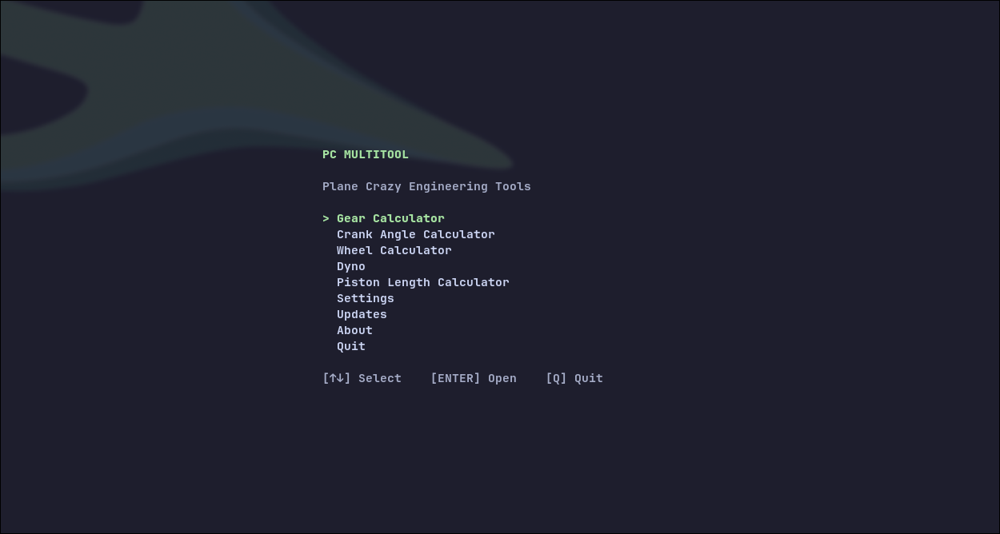
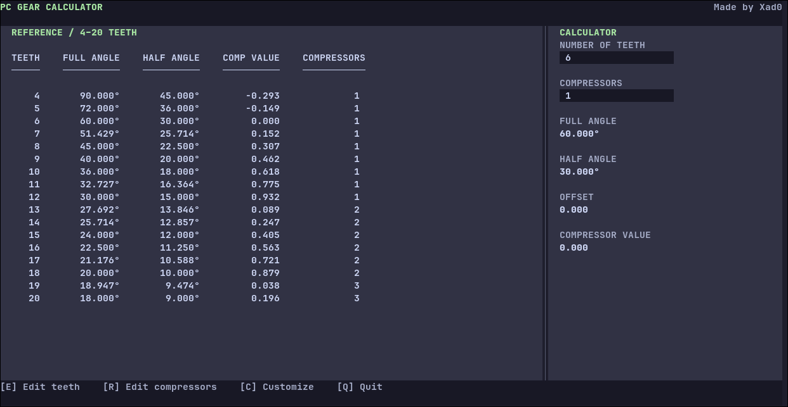
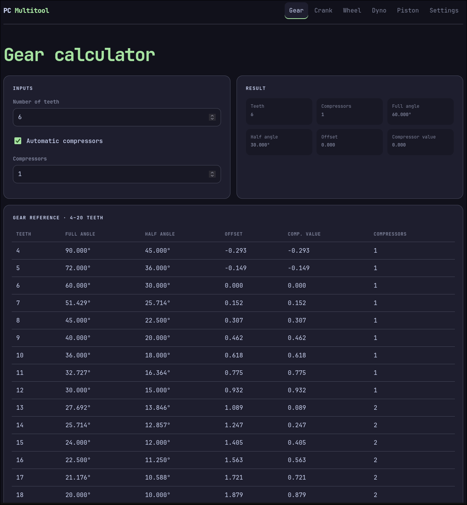
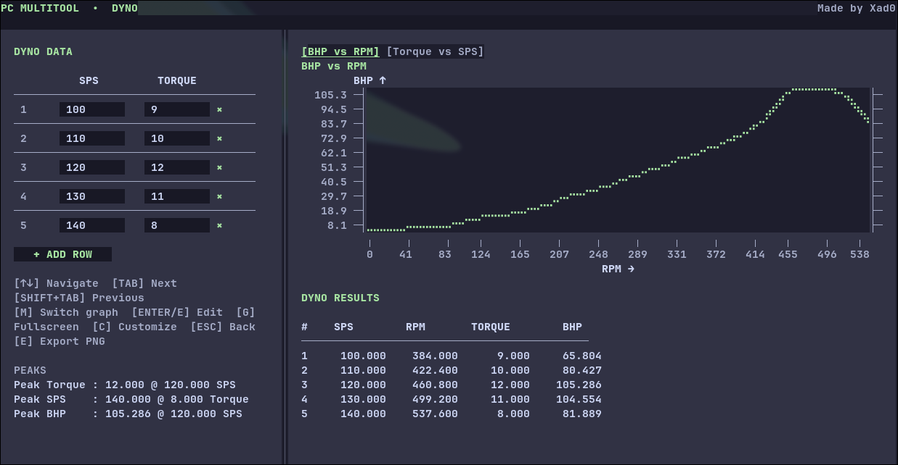

<div align="center">

# PC Multitool

**Engineering calculators for Plane Crazy — in your terminal or browser.**

[](https://github.com/xad0/Plane-crazy-multitool/releases/latest)
[](https://github.com/xad0/Plane-crazy-multitool/releases)

[**Open the web app**](https://xad0.github.io/Plane-crazy-multitool/) · [**Download for desktop**](https://github.com/xad0/Plane-crazy-multitool/releases/latest) · [Source code](https://github.com/xad0/Plane-crazy-multitool)

</div>


<p align="center">
  
  <br>
  <em>PC Multitool running in the terminal</em>
</p>

<p align="center">
  
  
</p>

<p align="center">
  
  <br>
  <em>The dyno graph and its measurements</em>
</p>

PC Multitool is a collection of calculators and engineering tools for building and tuning vehicles in **[Plane Crazy](https://www.roblox.com/games/166986752/Plane-Crazy)**. Use the responsive web app for quick calculations, or run the native terminal interface on your computer.

## Why use PC Multitool?

- **Calculate gear geometry:** work with gear angles, offsets, tooth counts and compressor values.
- **Work out crank and wheel values:** use dedicated calculators for crank angles and wheel/tire geometry.
- **Tune with the dyno:** inspect measurements in different graph modes, view peak readings, and export graphs as PNG images.
- **Calculate piston length:** get the value you need without doing the maths by hand.
- **Copy results quickly:** click supported result values to copy them instead of selecting text manually.
- **Make it yours:** customize themes, accent colors and layout in the terminal app; the web app also remembers settings in your browser.

## What's new in V3.0.0?

V3 brings a more capable dyno and a more convenient calculator workflow:

- Click-to-copy interactions for supported calculator results.
- Dyno graph modes for **BHP vs. RPM** and **torque vs. SPS**.
- Peak measurements and editable dyno data points.
- Smooth graph curves, fullscreen viewing and PNG export.
- Built-in, user-controlled updates with separate update channels.

See the [V3.0.0 release](https://github.com/xad0/Plane-crazy-multitool/releases/tag/v3.0.0) for downloads and the full changelog.

## Choose your version

| | Web app | Terminal app |
|---|---|---|
| Get started | [Open in your browser](https://xad0.github.io/Plane-crazy-multitool/) | [Download a desktop build](https://github.com/xad0/Plane-crazy-multitool/releases/latest) |
| Installation | None | Download and extract a platform package; Linux includes an installer script |
| Interface | Responsive graphical interface | Keyboard-driven terminal interface |
| Good for | Fast access on desktop, tablet or phone | A native desktop workflow with themes and configurable layout |

### Tools included

- **Gear calculator** — calculate gear angles and offsets, with compressor-related values and a reference chart.
- **Crank angle calculator** — calculate crank angles and related geometry.
- **Wheel calculator** — work out wheel/tire geometry and related values.
- **Dyno** — enter engine measurements, inspect the graph in either measurement mode, identify peaks and export a PNG.
- **Piston length calculator** — calculate piston length from your setup.
- **Gear reference chart** — quickly look up gear-related reference values.

The web app and terminal app do not necessarily have identical interfaces or every identical feature. Use the version that fits your workflow.

## Download

Get the current stable release from the **[GitHub Releases page](https://github.com/xad0/Plane-crazy-multitool/releases/latest)**. Choose the package for your platform:

- **Linux:** x86-64 / AMD64 ZIP
- **Windows:** x86-64 / AMD64 ZIP or setup executable
- **macOS Intel:** x86-64 ZIP
- **macOS Apple Silicon:** ARM64 ZIP

## Installation

### Linux

1. Download and extract the **Linux x64** ZIP from the [latest release](https://github.com/xad0/Plane-crazy-multitool/releases/latest).
2. Open a terminal in the extracted `PC-Multitool` directory.
3. Run the included installer:

   ```bash
   ./install.sh
   ```

The installer places the application in `~/.local/opt/PC-Multitool/` and creates the launcher `~/.local/bin/pc-multitool` plus a desktop entry at `~/.local/share/applications/pc-multitool.desktop`. It does not require a system-wide installation.

Launch it from your application menu (for example, Rofi) or run:

```bash
pc-multitool
```

If the command is not found, check that `~/.local/bin` is in your `PATH`. You can run the full path directly as `~/.local/bin/pc-multitool`.

### Windows

Download either the Windows x64 ZIP or the setup executable from the [latest release](https://github.com/xad0/Plane-crazy-multitool/releases/latest). For the ZIP, extract it and run `PC-Gear-Calculator.exe`. The setup executable provides an alternative installation path.

Windows SmartScreen may warn that the executable is unrecognized because the app is not code-signed.

### macOS

Download the matching ZIP from the [latest release](https://github.com/xad0/Plane-crazy-multitool/releases/latest):

- **Intel Mac:** macOS x64
- **Apple Silicon Mac:** macOS arm64

Extract the package and run the application.

## Updating the terminal app

Updates are started manually from **Updates** inside the terminal app. PC Multitool does not silently install updates in the background.

The app offers three update channels:

- **Edge** — offers every eligible stable release. This is the default for regular release builds.
- **Ironclad** — offers only stable releases marked `important` or `critical`.
- **Workshop** — for development builds; lets developers inspect available releases, but does not install them through the updater.

To check for an update, open **Updates**, choose **Check for updates**, then choose **Update** when a newer version is available. The application may exit while the external updater replaces the executable, then attempt to launch the updated version. If you launched it in a terminal window that closes automatically, reopen PC Multitool to confirm the installed version.

## Appearance

The terminal app includes **Catppuccin Mocha, Nord, Gruvbox and Solid** themes, plus configurable accent colors and layout options. The web app saves its settings in your browser.

## Links

- [Open the web app](https://xad0.github.io/Plane-crazy-multitool/)
- [Latest stable release and downloads](https://github.com/xad0/Plane-crazy-multitool/releases/latest)
- [All releases and changelogs](https://github.com/xad0/Plane-crazy-multitool/releases)
- [Source code](https://github.com/xad0/Plane-crazy-multitool)
